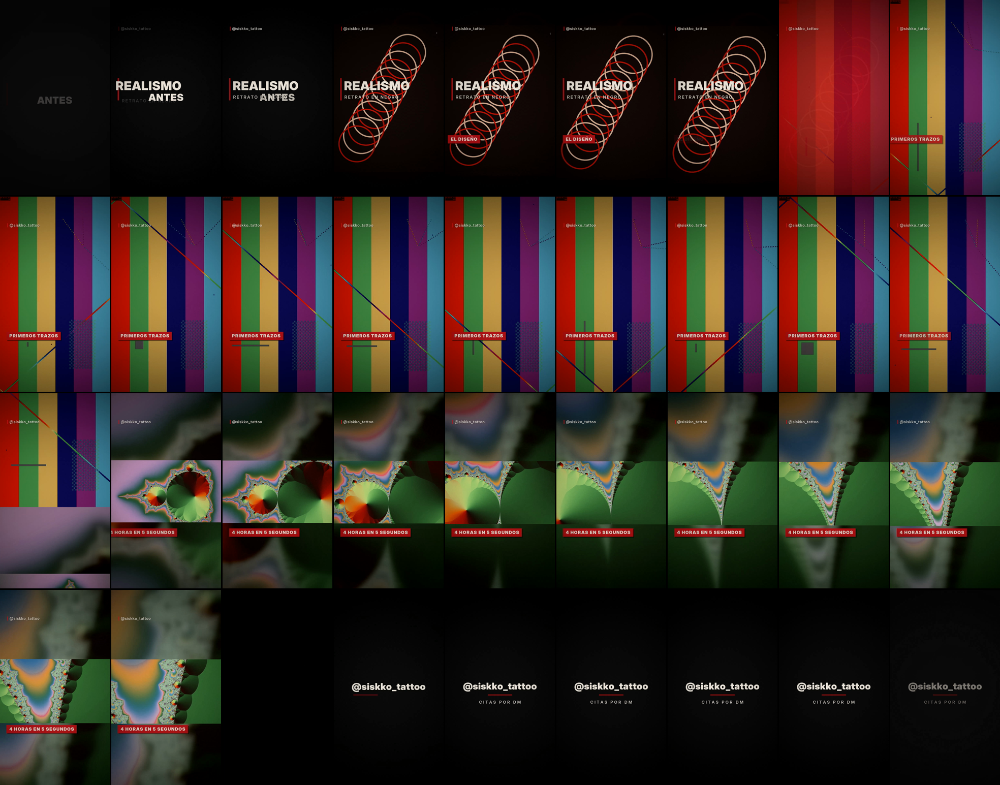
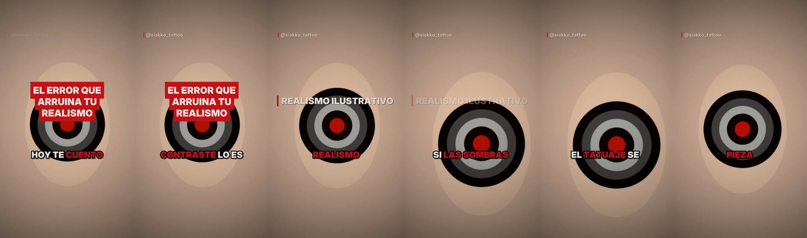
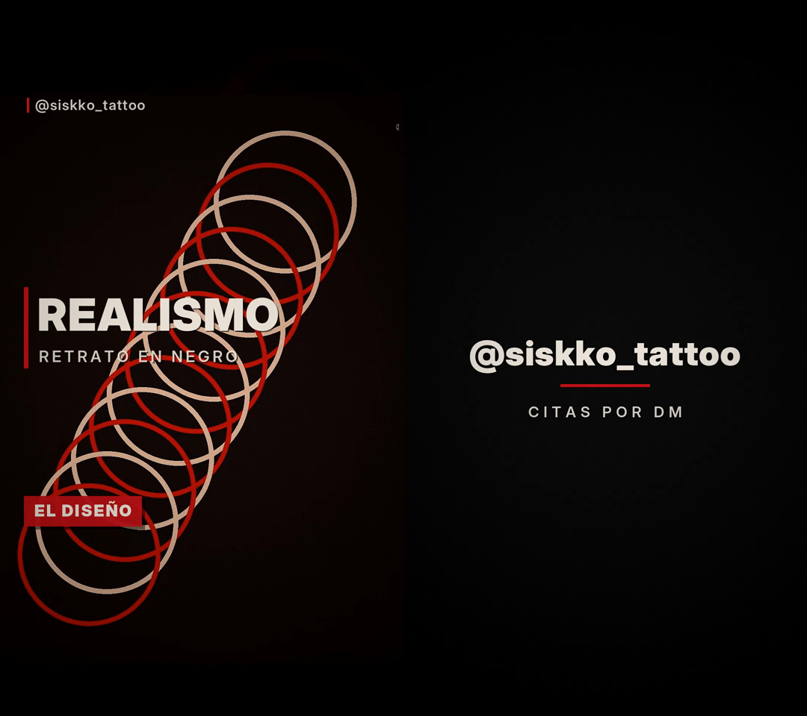
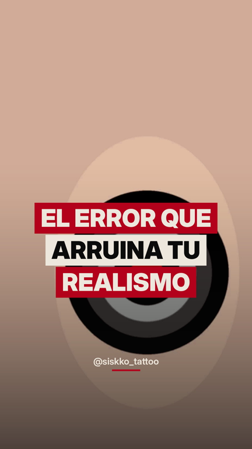

# Edición de Reels · @siskko_tattoo

Montaje profesional y automático de reels para **siskko_tattoo**: pasas los
vídeos y fotos del iPhone y sale el reel terminado, listo para publicar.



## Qué hace

| | |
|---|---|
| **Recorte** | Inicio/fin por clip, y quita los silencios y pausas de lo hablado (cortes de ritmo tipo *jump cut*) |
| **Timelapse** | Los procesos largos se aceleran automáticamente para caber en el reel |
| **Encuadre 9:16** | Vertical a pantalla completa; lo horizontal va entero sobre fondo desenfocado |
| **Color de marca** | Realismo ilustrativo: alto contraste, negros densos, claridad en el sombreado, rojo sangre como único color vivo (LUT propio); HDR del iPhone convertido a SDR |
| **Movimiento** | Empuje lento de cámara en vídeos, efecto Ken Burns en fotos |
| **Transiciones** | Zoom, fundido a negro, destello rojo sangre, deslizamiento, corte seco… sincronizadas al golpe de la música |
| **Grafismo animado** | Título de apertura, rótulos en caja roja, tarjetas de texto ("ANTES"/"DESPUÉS"), cierre con `@siskko_tattoo · CITAS POR DM` |
| **Música** | Tu canción (se detecta el tempo para cortar a ritmo) o una base oscura generada sin derechos; baja sola cuando se habla (*ducking*) |
| **Subtítulos dinámicos** | Transcripción automática (Whisper, local): palabra a palabra, mayúsculas, la palabra hablada en rojo sangre con "pop" y términos clave siempre en rojo |
| **Gancho** | Frase grande en caja roja en el primer segundo, con golpe de sonido |
| **Retención** | Cortes entre palabras (quita pausas y muletillas largas) con salto de zoom en cada corte |
| **Sonido** | Whoosh en transiciones e impacto en el gancho (sintéticos, sin derechos) |
| **Portada** | `*_portada.jpg` con el gancho en cajas, pensada para el recorte 3:4 del perfil |
| **Acabado** | Viñeta, grano de película, marca de agua fija, fundidos, audio a −14 LUFS, 1080×1920 30 fps H.264 |



 

## Uso

```bash
sudo apt-get install ffmpeg
pip install -r requirements.txt
```

**Automático** — monta todo con decisiones por defecto:

```bash
python montar.py auto entrada/IMG_1.MOV entrada/IMG_2.MOV entrada/foto.jpg \
    --gancho "El error que arruina tu realismo" \
    --titulo "Realismo ilustrativo" --musica entrada/tema.mp3 --destacar sombras
```

Opciones: `--gancho`, `--destacar palabra…`, `--sin-subtitulos`, `--sin-sfx`, `--duracion 30` (objetivo en segundos), `--sin-musica`, `--sin-cortes`,
`--sin-timelapse`, `--guardar-proyecto proyectos/x.json` (para retocarlo después),
`--borrador` (render rápido de prueba). Sin `--musica` usa la base generada.

**Proyecto** — control plano a plano con un JSON
(ver [`proyectos/ejemplo.json`](proyectos/ejemplo.json)):

```bash
python montar.py proyecto proyectos/mi_reel.json
```

Campos generales: `gancho`, `titulo`, `subtitulo`, `subtitulos` (true/false),
`destacar` (lista de palabras en rojo), `sfx`, `portada`, `musica`, `musica_inicio`,
`musica_volumen`, `sincronizar_ritmo`, `transicion`, `cierre`.

### Campos de cada clip

| Tipo | Campos |
|---|---|
| `video` | `inicio`, `fin`, `velocidad`, `cortar_silencios` (sí por defecto), `voz` (se detecta sola: si se habla, la música baja), `volumen`, `zoom`, `encuadre` (`auto`/`llenar`/`relleno`), `color` |
| `foto` | `duracion`, `zoom`, `encuadre`, `color` |
| `tarjeta` | texto sobre negro, `duracion` |
| todos | `texto` (rótulo animado), `transicion` hacia el siguiente |

Transiciones: `rotar` (por defecto), `flash`, `corte`, o cualquiera de ffmpeg
*xfade*: `zoomin`, `fadeblack`, `slideup`, `circleopen`, `dissolve`, `pixelize`…

Las rutas de entrada se buscan desde la carpeta actual y, si no existen, junto al
JSON. La `salida` es relativa a la carpeta actual.

El modelo de transcripción (~460 MB) se descarga de huggingface.co la primera vez;
el entorno de nube `edicion-reels-siskko` ya tiene ese acceso permitido.

## Ajustar el estilo

Todo en [`estilo.py`](estilo.py): colores, viñeta, grano, zoom, transiciones,
umbral de silencio, volúmenes, tamaños y posiciones del grafismo. Si existe
`assets/logo.png`, aparece en el cierre. Si cambias `LUT_PARAMS`, ejecuta
`python generar_lut.py`.

El LUT [`luts/siskko_dark_rojo.cube`](luts/siskko_dark_rojo.cube) también se puede
cargar en CapCut, Premiere, DaVinci o VN.

## Música y derechos

Una canción comercial subida dentro del vídeo puede hacer que Instagram silencie el
reel. Opciones seguras: la base generada (`musica_generada.py`), música libre de
derechos, o publicar el reel con el audio bajado y añadir la canción desde la
biblioteca de Instagram.

## Archivos

- `montar.py` — motor de montaje
- `graficos.py` — títulos, rótulos, marca y sus animaciones
- `audio.py` — detección de silencios y de tempo/golpes
- `subtitulos.py` — transcripción y subtítulos animados (ASS)
- `sfx.py` — efectos de sonido
- `musica_generada.py` — base musical oscura sin derechos
- `generar_lut.py` — genera el LUT de color
- `estilo.py` — guía de estilo

Fuentes: Inter Display (licencia OFL, ver `assets/fonts/`).
