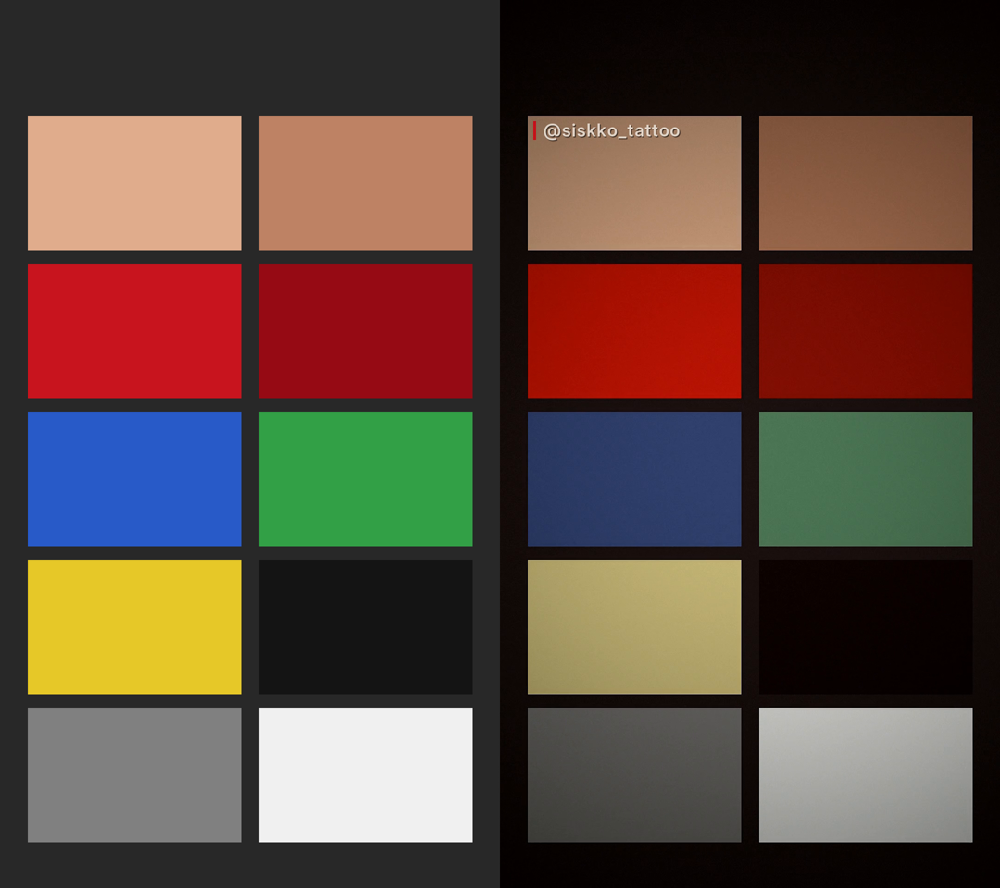

# Edición de Reels · @siskko_tattoo

Estilo de edición automática para los reels de Instagram de **siskko_tattoo**:
pasas el vídeo grabado con el iPhone y sale listo para publicar.



## El estilo

| | |
|---|---|
| **Paleta** | Negro `#0B0B0C` · Rojo sangre `#B3001B` · Blanco roto `#EDE6DC` |
| **Look** | Dark cinematográfico: rojos intensos y oscuros, piel natural, el resto de colores casi desaturado, sombras rojo-negro, negros mate |
| **Acabado** | Viñeta, grano de película fino, realce de la línea del tatuaje, fundido desde/hacia negro |
| **Marca** | `@siskko_tattoo` fijo arriba a la izquierda (dentro de la zona segura de Reels) con barra roja sangre |
| **Formato** | 1080×1920 (9:16), 30 fps, H.264 + AAC, audio normalizado a −14 LUFS |

Los vídeos HDR del iPhone (HLG / Dolby Vision) se convierten automáticamente a SDR
para que Instagram no los queme ni los lave.

## Uso

```bash
sudo apt-get install ffmpeg
pip install -r requirements.txt
python generar_lut.py                 # solo la primera vez o si cambias el color

python editar_reel.py IMG_1234.MOV                       # → salida/IMG_1234_siskko.mp4
python editar_reel.py IMG_1234.MOV --inicio 3 --fin 28   # recorte
python editar_reel.py IMG_1234.MOV --musica tema.mp3     # cambia el audio
python editar_reel.py IMG_1234.MOV --silencio            # sin audio
```

## Ajustar el estilo

Todo está en [`estilo.py`](estilo.py): colores, intensidad de viñeta y grano,
saturación de rojos / piel / resto, posición y tamaño de la marca.
Si tocas `LUT_PARAMS`, vuelve a ejecutar `python generar_lut.py`.

El LUT [`luts/siskko_dark_rojo.cube`](luts/siskko_dark_rojo.cube) también se puede
cargar en CapCut, Premiere, DaVinci o VN para editar a mano con el mismo color.

Fuente de la marca: Inter Display SemiBold (licencia OFL, ver `assets/fonts/`).
